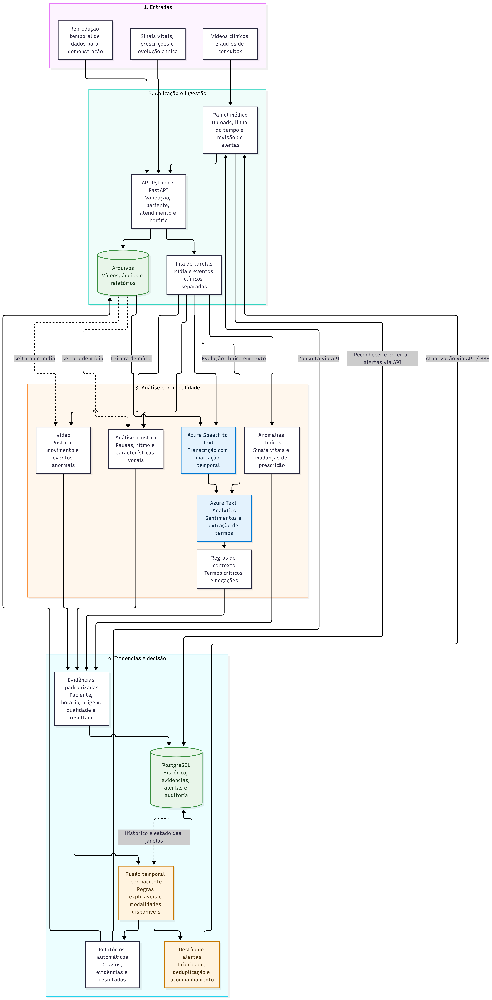

# Arquitetura implementada

O diagrama de arquitetura está disponível em [PNG](architecture.png) e [Mermaid](architecture.mmd).

## Componentes e decisões

A implementação é modular em Python com uv. FastAPI valida e recebe eventos; PostgreSQL mantém pacientes, atendimentos e evidências, além de tarefas/alertas versionados na tabela `runtime_records`. Arquivos e relatórios ficam no diretório local `data`, compartilhado pelos processos. Azure Blob Storage não foi implementado.

Sinais vitais e prescrições usam análise síncrona curta na API. Texto segue para a fila `clinical`; áudio e vídeo, para `media`. Celery usa Redis como transporte. As tarefas são persistidas antes do envio. Um agendador a cada cinco segundos recupera tarefas pendentes ou com lease expirado e recalcula alertas. Atualizações de estado usam comparação de versão para evitar sobrescritas concorrentes. Há no máximo três tentativas por tarefa por padrão.

YOLOv8n-pose/OpenCV extrai geometria e movimento. NumPy/SciPy extrai características acústicas. Azure Speech transcreve e Azure Language retorna sentimento e frases-chave. Regras locais de vocabulário e negação contextualizam o texto. Falhas externas produzem análise parcial quando há evidências locais; o reprocessamento reaproveita evidências idempotentes.

A fusão agrupa evidências do mesmo atendimento em janelas UTC fixas de 60 segundos. Anomalias de sinais vitais/prescrições ou de duas modalidades geram prioridade alta; uma modalidade restante gera moderada. A ausência de modalidades permanece explícita. A fronteira entre janelas pode separar eventos temporalmente próximos; não há janela deslizante nesta versão.

O painel acompanha novos alertas em um fragmento somente de leitura a cada cinco segundos. As listas permitem atualização manual ou automática opcional a cada dez segundos. Os formulários ficam fora do acompanhamento contínuo. Não há SSE, captura ao vivo de áudio/vídeo ou entrega de notificações externas. A equipe pode reconhecer e encerrar alertas com responsável e observação; novas evidências anômalas reabrem alertas encerrados e preservam histórico.

## Contratos e rastreabilidade

As evidências preservam paciente/atendimento/origem, modalidade, horário observado, intervalo, processamento, detector/versão, qualidade, referência, valor/unidade, critérios e confiança quando aplicável. Regras determinísticas não recebem probabilidade artificial. O identificador determinístico permite replay idempotente, e conteúdo divergente com o mesmo identificador gera conflito.

Relatórios JSON/HTML consolidam evidências, tarefas, alertas e limitações. Metadados e evidências têm validações de vínculo, intervalo, UTC e unidade. A interface apresenta os horários recebidos em UTC. O extrator de pose é pré-treinado; classificadores logísticos experimentais usam características acústicas e geométricas, com desenvolvimento/validação/teste separados por participante. Coeficientes, normalização, versão e procedência acompanham os modelos. Escores não são apresentados como probabilidades clínicas calibradas.

O perfil e o idioma fazem parte da identidade imutável de cada tarefa. O perfil de consulta não transforma silêncio entre turnos em anomalia vocal. Textos em português/inglês preservam termos positivos e negados, frases-chave Azure e sentimento contextual; a evolução compara menções à anotação anterior disponível. Medições individuais alimentam automaticamente uma janela temporal limitada pela regra configurada; episódios antigos deixam de compor novas janelas após esse horizonte.

## Fronteiras operacionais

PostgreSQL e Redis foram validados em Docker, aplicação e trabalhadores em processos locais, com chamadas reais aos recursos Azure configurados. O perfil completo Docker foi preparado, mas não executado. O desenho representa responsabilidades; não implica um microsserviço por caixa nem que recursos futuros já existam.

Token compartilhado opcional protege `/v1`; não há RBAC, retenção automatizada, criptografia de arquivos ou implantação de produção. As listagens têm limite de 1.000 registros e não implementam paginação. A escala validada é a demonstração local. Dados reais exigem uma etapa própria de segurança, governança e validação clínica.
